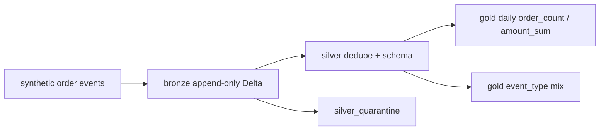

# Databricks + Delta Lake — bronze / silver / gold

Local PySpark + `delta-spark` pipeline for synthetic e-commerce **order events**, exercising Delta append, MERGE, and `VERSION AS OF` time travel. This is a lakehouse mechanics repo, not a copy of the warehouse star schema.

## Architecture



See `docs/architecture.md` for ACID / time travel notes and a **design knowledge** cluster-config section.

## Local vs Databricks

| Path | What it is |
|---|---|
| `src/` + `tests/test_pipeline.py` | Runs locally and in GitHub Actions with PySpark 3.5.3 + delta-spark 3.2.1. No Databricks workspace or credentials. |
| `dlt_pipeline/orders_dlt.py` | Real `@dlt.table` / `@dlt.expect_or_drop` definitions for a Databricks workspace with **Delta Live Tables enabled**. This file has not been run in a workspace in this repo yet. Local tests do not import it. |
| `notebooks/databricks_pipeline.ipynb` | Plain PySpark + Delta equivalent for an all-purpose cluster **without** DLT. Designed for Community Edition or any all-purpose cluster; it has not been executed in a workspace from this repo. |

Do not read cluster sizing, DBU cost, node types, or autoscaling out of this README — none of that was run here.

## Quick start (CI target)

```bash
python -m pip install -r requirements.txt
python -m pytest tests/test_pipeline.py -q
```

CI uses Java 17 and Python 3.11 on `ubuntu-latest`. Spark on Windows is often painful (Hadoop native binaries); if a local Windows session fails to start Spark, treat GitHub Actions as the accept run.

Warehouse / Delta paths default to a pytest temp dir (or `./spark-warehouse` if you point scripts there). Both are gitignored.

## Pipeline

- **bronze** — append-only Delta; raw events as-is, including poison rows.
- **silver** — dedupe on `event_id`; `event_id` required; `amount` must be numeric `>= 0`. Failures go to `silver_quarantine`, never silently dropped.
- **gold** — daily `order_count` (distinct `order_id`) and `sum(amount)` by `event_date`, plus an `event_type` mix. Not `fct_orders` / `dim_*`.

## Delta mechanics

- **MERGE** — replay of the same `event_id` updates silver in place; new ids insert.
- **Time travel** — after MERGE inserts new `event_id`s, a local run of `test_merge_and_time_travel_counts` printed:

  ```
  VERSION AS OF 0: 40 rows
  current: 46 rows
  ```

  The matched `evt-0001` row updated in place (amount became `111.11`). `VACUUM` is not run in tests; default retention is 7 days (168 hours).

## Layout

```
src/bronze_ingest.py         append-only bronze Delta
src/silver_transform.py      dedupe, schema, quarantine
src/gold_aggregate.py        daily metrics + event_type mix
src/delta_mechanics.py       MERGE, VERSION AS OF, VACUUM note
src/generate_events.py       seeded events + poison rows
dlt_pipeline/orders_dlt.py   workspace DLT (not run from this repo yet)
notebooks/databricks_pipeline.ipynb
tests/test_pipeline.py
docs/architecture.md
```
