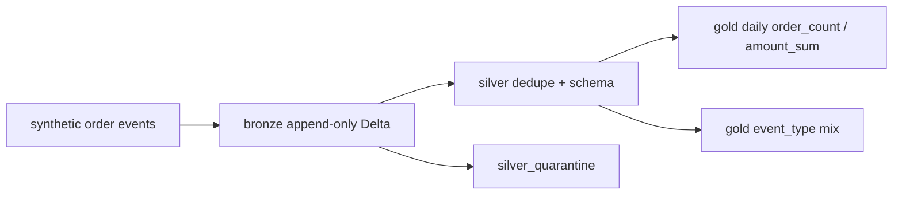

# Databricks + Delta Lake — bronze / silver / gold

## Investment Data Engineering Extensions

Additive Fixed Income / asset-management demos. The original e-commerce bronze / silver / gold pipeline is unchanged.

| Folder | What it shows |
|---|---|
| [fi_autoloader/](fi_autoloader/) | Hourly Auto Loader path (cloudFiles + local batch fallback) into Holding Master MERGE |
| [fi_cost/](fi_cost/) | System-table cost per job / team / workspace + 6-hour run cancel |
| [fi_benchmark/](fi_benchmark/) | MERGE vs append-then-update, OPTIMIZE / VACUUM / liquid clustering |
| [fi_uc/](fi_uc/) | Unity Catalog grants, row filter, column mask, SCD2 Security Master, bitemporal holdings |
| [fi_admin/](fi_admin/) | Jobs API listing for `fi-*` jobs |
| [fi_mlflow/](fi_mlflow/) | Toy duration model with optional MLflow logging |
| [databricks.yml](databricks.yml) | Asset Bundle `dev` / `prod` targets wrapping the FI jobs and DLT pipeline |

### Fixed Income Auto Loader Path

`fi_autoloader/` writes synthetic hourly JSON (`instrument_id`, `cusip`, `isin`, `price`, `yield`, `volume`, `position_qty`, `account_id`, `as_of_ts`). On Databricks, `cloudFiles` uses schema evolution and `rescuedDataColumn`, lands in hourly-partitioned silver, then MERGEs gold on `account_id + instrument_id + as_of_ts`. Config is `fi_autoloader/config.yaml`; pack with `python -m pip wheel --no-deps -w dist fi_autoloader`.

### Cost observability

SQL under `fi_cost/sql/` joins `system.billing.usage` to `system.billing.list_prices` and `system.lakeflow.*`. Sample CSVs run locally. `cancel_long_runs.py` flags runs longer than six hours (`--dry-run` default). Verify the exact system table names in Catalog Explorer.

### MERGE vs append-then-update

| Path | Runtime s (approx) | Files before OPTIMIZE | Files after OPTIMIZE | Files after VACUUM | Liquid clustering |
|---|---|---|---|---|---|
| MERGE | 2.8 | 4 | 1 | 1 | n/a locally |
| append-then-update | 3.1 | 5 | 1 | 1 | n/a locally |

Takeaway: on this tiny local dataset both paths finish in seconds; MERGE keeps matched keys in place, while append-then-update writes extra files until OPTIMIZE/VACUUM compact them.

### Asset Bundles

```bash
databricks bundle validate --target dev
# databricks bundle deploy --target dev   # requires a real workspace
```

Replace the placeholder host in `databricks.yml`. CI runs `pytest`, then `databricks bundle validate` (continues if no workspace). Deploy is commented for free tier.

### Unity Catalog and the investment-data model

Security Master = SCD2 `apply_changes` (`fi_uc/dlt_security_master.py`). Holding Master = bitemporal table (`as_of_date`, `recorded_at`). Transaction Master is the cashflow/trade grain produced by the streaming-service FI topics. Grants, row filters, and CUSIP masks are in `fi_uc/*.sql`.

---

Local PySpark + `delta-spark` pipeline for synthetic e-commerce **order events**, exercising Delta append, MERGE, and `VERSION AS OF` time travel. This is a lakehouse mechanics repo, not a copy of the warehouse star schema.

## Architecture



See `docs/architecture.md` for ACID / time travel notes and a **design knowledge** cluster-config section.

## Local vs Databricks

| Path | What it is |
|---|---|
| `src/` + `tests/test_pipeline.py` | Runs locally and in GitHub Actions with PySpark 3.5.3 + delta-spark 3.2.1. No Databricks workspace or credentials. |
| `dlt_pipeline/orders_dlt.py` | Real `@dlt.table` / `@dlt.expect_or_drop` definitions for a Databricks workspace with **Delta Live Tables enabled**. This file has not been run in a workspace in this repo yet. Local tests do not import it. |
| `notebooks/databricks_pipeline.ipynb` | Plain PySpark + Delta equivalent for an all-purpose cluster **without** DLT. Designed for Community Edition or any all-purpose cluster; it has not been executed in a workspace from this repo. |

Do not read cluster sizing, DBU cost, node types, or autoscaling out of this README — none of that was run here.

## Quick start (CI target)

```bash
python -m pip install -r requirements.txt
python -m pytest tests/test_pipeline.py -q
```

CI uses Java 17 and Python 3.11 on `ubuntu-latest`. Spark on Windows is often painful (Hadoop native binaries); if a local Windows session fails to start Spark, treat GitHub Actions as the accept run.

Warehouse / Delta paths default to a pytest temp dir (or `./spark-warehouse` if you point scripts there). Both are gitignored.

## Pipeline

- **bronze** — append-only Delta; raw events as-is, including poison rows.
- **silver** — dedupe on `event_id`; `event_id` required; `amount` must be numeric `>= 0`. Failures go to `silver_quarantine`, never silently dropped.
- **gold** — daily `order_count` (distinct `order_id`) and `sum(amount)` by `event_date`, plus an `event_type` mix. Not `fct_orders` / `dim_*`.

## Delta mechanics

- **MERGE** — replay of the same `event_id` updates silver in place; new ids insert.
- **Time travel** — after MERGE inserts new `event_id`s, a local run of `test_merge_and_time_travel_counts` printed:

  ```
  VERSION AS OF 0: 40 rows
  current: 46 rows
  ```

  The matched `evt-0001` row updated in place (amount became `111.11`). `VACUUM` is not run in tests; default retention is 7 days (168 hours).

## Layout

```
src/bronze_ingest.py         append-only bronze Delta (e-commerce, unchanged)
src/silver_transform.py      dedupe, schema, quarantine
src/gold_aggregate.py        daily metrics + event_type mix
src/delta_mechanics.py       MERGE, VERSION AS OF, VACUUM note
src/generate_events.py       seeded events + poison rows
dlt_pipeline/orders_dlt.py   workspace DLT (not run from this repo yet)
notebooks/databricks_pipeline.ipynb
fi_autoloader/               FI Auto Loader + wheel
fi_cost/                     billing system-table queries
fi_benchmark/                MERGE vs append-then-update
fi_uc/                       UC grants, SCD2, bitemporal holdings
fi_admin/                    Jobs API
fi_mlflow/                   duration toy model
databricks.yml               Asset Bundles (dev / prod)
tests/test_pipeline.py
docs/architecture.md
```
