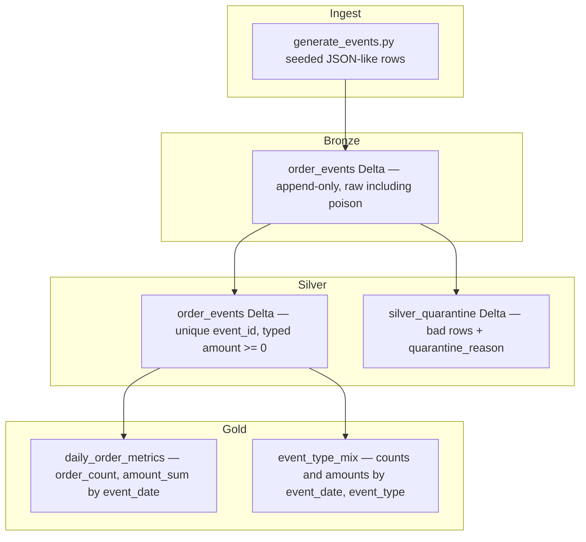

# Architecture — bronze / silver / gold on Delta

Synthetic e-commerce **order events** (`event_id`, `order_id`, `customer_id`, `event_type`, `amount`, `event_ts`) land as a stream of facts, then are cleaned and aggregated. This is not a dimensional star (`fct_orders` / `dim_*`).

## Medallion flow



Local execution is `src/*.py` with PySpark + `delta-spark`. The Databricks DLT rewrite lives in `dlt_pipeline/orders_dlt.py` and has **not** been run in a workspace from this repo.

## ACID via the Delta transaction log

Each table is a Delta Lake table: parquet data files plus a `_delta_log` JSON/checkpoint log. Writes (append, overwrite, MERGE) commit as atomic versions. Readers see a consistent snapshot; a failed job does not leave a half-written table visible as current.

## Time travel

Every commit is a table version. After the initial silver write (version 0) and a MERGE (later version):

```sql
SELECT count(*) FROM delta.`/path/to/silver` VERSION AS OF 0;
SELECT count(*) FROM delta.`/path/to/silver`;
```

`src/delta_mechanics.py` prints both counts. A local run of `test_merge_and_time_travel_counts` printed:

```
VERSION AS OF 0: 40 rows
current: 46 rows
```

That is after the initial silver write (40 unique `event_id`s) plus a MERGE that inserted 6 new ids and updated `evt-0001` in place.

## VACUUM

Delta `VACUUM` removes data files no longer referenced by the transaction log, subject to a retention window. **Default retention is 7 days (168 hours).** This repo documents that default in `document_vacuum_behavior()` and does **not** run `VACUUM` in tests or CI — doing so would delete history that `VERSION AS OF` checks need.

## Cluster config — design knowledge

Nothing below was sized, billed, or executed on a Databricks workspace for this repo. Treat it as design knowledge, not a run log. There are no DBU costs, node types, or autoscaling ranges claimed as observed.

**Job cluster vs all-purpose.** An all-purpose (interactive) cluster is what notebooks and Community Edition typically use: the cluster stays up while you explore. A job cluster is created for a scheduled job or DLT pipeline update and torn down after; that is the usual choice for unattended bronze→silver→gold so you are not paying for idle interactive VMs. This repo's CI uses local `local[2]` Spark instead of either.

**Autoscaling.** Autoscaling adds/removes workers from a min/max range as task parallelism changes. It is a workspace policy choice (and still design knowledge here). Local tests fix `local[2]` and `spark.sql.shuffle.partitions=2` so the suite stays small and deterministic.

**Photon.** Photon is Databricks' vectorized engine for SQL/Delta on supported runtimes. Enabling it is a workspace checkbox / runtime feature; this repo does not assert Photon on or off because no cluster was started. The local path is open-source Spark + delta-spark, which is not Photon.
